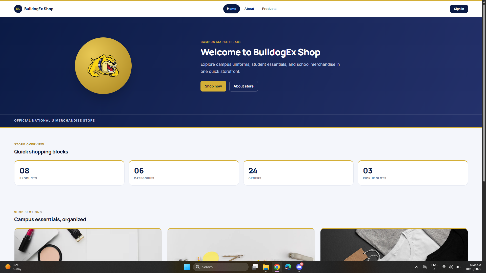
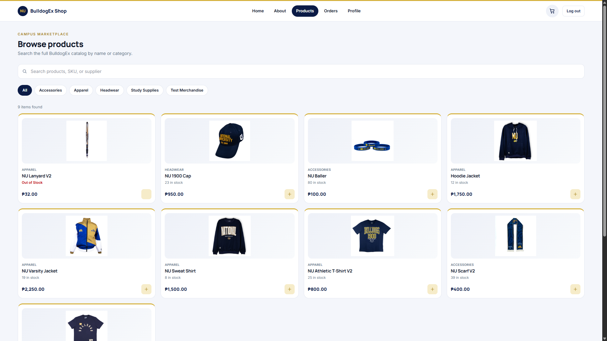
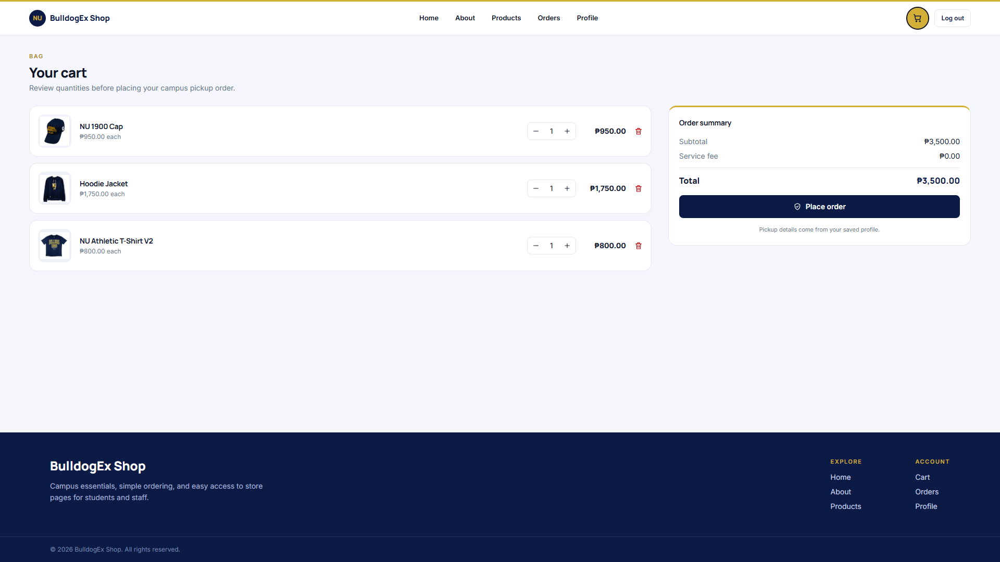
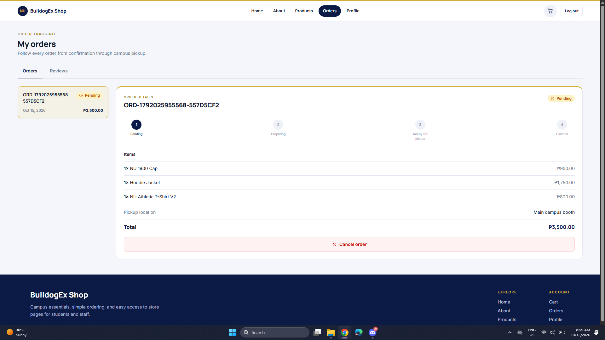
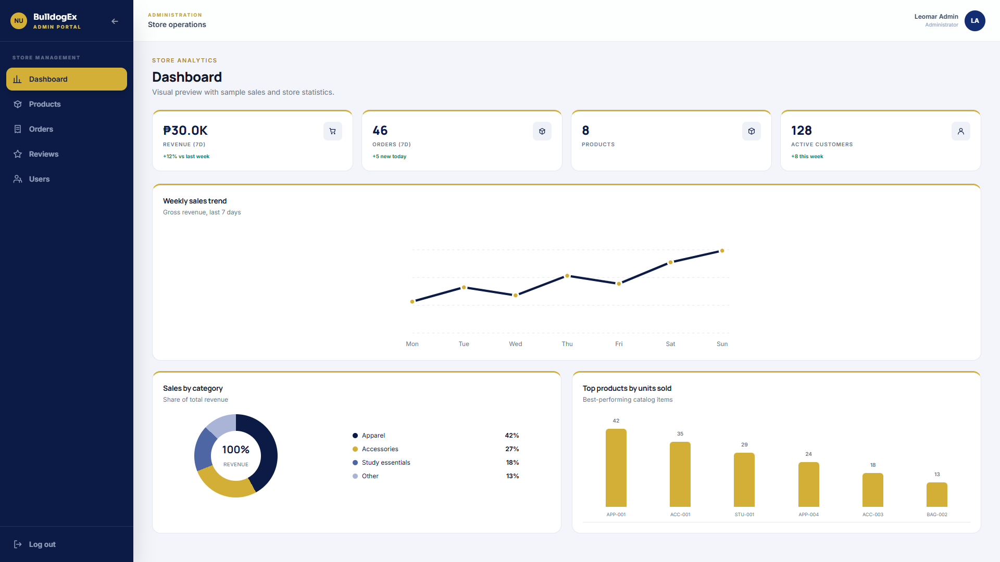
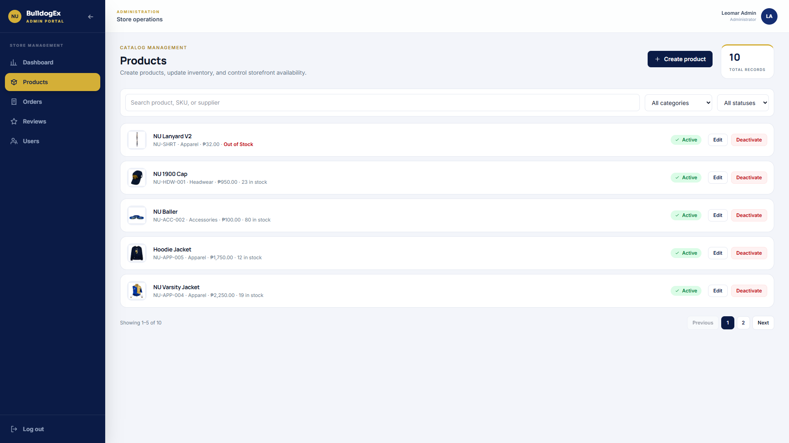
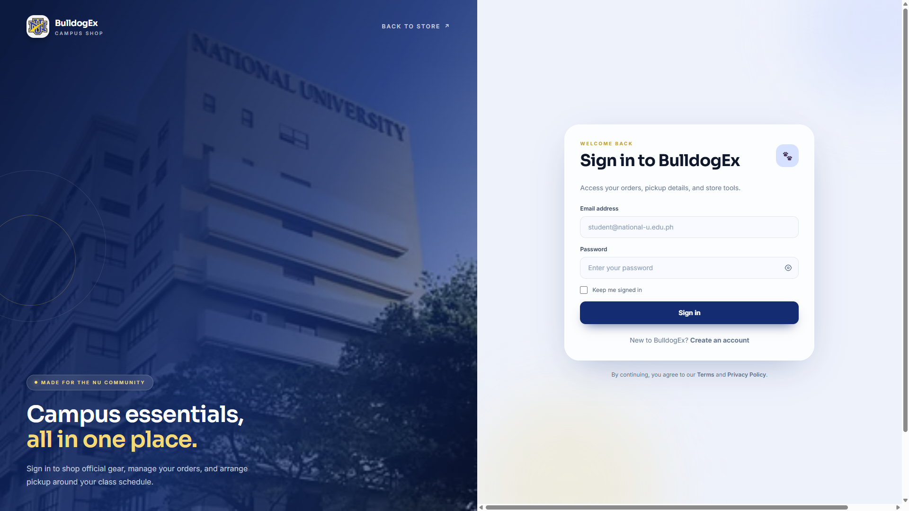

# BulldogEx Shop

**A full-stack campus e-commerce application for browsing university merchandise, placing pickup orders, and managing store operations.**

[**Live demo**](https://bulldogex-client.vercel.app) · [**Deployment guide**](DEPLOYMENT.md)

## Overview

BulldogEx Shop combines a customer-facing campus storefront with a role-restricted administration portal. Customers can browse merchandise, manage their carts, place pickup orders, track fulfillment, and manage accounts. Administrators manage inventory, orders, reviews, and users. A React frontend communicates with an Express REST API backed by MongoDB.

This began as an **Advanced Web Programming academic project** using an instructor-provided frontend starter template. I extended the frontend and implemented backend functionality, API integration, and deployment. Original commit authorship is preserved.

## Features

### Customer experience

- Browse and search products by name, SKU, or supplier; filter by category.
- View prices, availability, and product details.
- Manage cart quantities and select products for checkout.
- Place campus pickup orders and track **Pending → Preparing → Ready for pickup → Claimed**.
- Register, sign in, view order history, manage a profile, and submit reviews.

### Administration

- View a dashboard with **sample** sales metrics and charts (not real revenue reporting).
- Create, edit, activate/deactivate, and manage product inventory.
- Review order details and update fulfillment status.
- Moderate reviews and manage user accounts.
- Enforce role-based permissions and resource ownership on the backend.

## Screenshots

Screenshots of the storefront, catalog, cart, order tracking, dashboard, product management, and sign-in experience are prepared for this portfolio. They will appear here after the image assets are added to `assets/screenshots/`.

<!-- Uncomment after uploading the corresponding image files to assets/screenshots/.


| Product catalog | Cart and order summary |
| --- | --- |
|  |  |



| Dashboard (sample data) | Product management |
| --- | --- |
|  |  |


-->

## Technology stack

| Layer | Technologies |
| --- | --- |
| Frontend | React, Vite, React Router, Tailwind CSS |
| Backend | Node.js, Express |
| Database | MongoDB, Mongoose |
| Authentication | JWT, bcryptjs |
| API integration | Browser Fetch API, centralized API client |
| Security | Server-side validation, authorization, Helmet, CORS, rate limiting |
| Images | Multer, Cloudinary (production) |
| Deployment | Vercel, MongoDB Atlas |

## Architecture

```text
React client
    │ Fetch API + optional Bearer JWT
    ▼
Express REST API (/api/v1)
    │ Authentication · authorization · validation
    ▼
Controllers → Mongoose models → MongoDB
    │
    └── JSON response → React state → UI
```

The frontend uses an authentication provider, protected route guards, and a shared API client. **Client-side guards improve UX but are not the security boundary**: the server verifies JWTs and independently enforces roles and resource ownership.

### API route groups

| Route | Purpose |
| --- | --- |
| `/api/v1/users` | Registration, login, sessions, profiles, user management |
| `/api/v1/categories` | Product categories |
| `/api/v1/products` | Catalog and inventory management |
| `/api/v1/carts` | Customer cart operations |
| `/api/v1/orders` | Checkout, history, fulfillment |
| `/api/v1/reviews` | Reviews and moderation |
| `/api/v1/health` | Health check |

## Run locally

**Requirements:** Node.js 20+, npm, MongoDB. Client and server have separate dependencies.

1. Clone:

   ```bash
   git clone https://github.com/irleo/bulldog-ex.git
   cd bulldog-ex
   ```

2. Create `garzon-server/.env`:

   ```dotenv
   NODE_ENV=development
   PORT=5000
   MONGO_URI=mongodb://127.0.0.1:27017/bulldogs_exchange
   CLIENT_ORIGIN=http://localhost:5173
   JWT_SECRET=replace-with-a-long-random-secret
   JWT_EXPIRES_IN=8h
   ```

3. Start the backend:

   ```bash
   cd garzon-server
   npm install
   npm run dev
   ```

4. In a separate terminal, create `garzon-client/.env`:

   ```dotenv
   VITE_API_URL=http://localhost:5000/api/v1
   ```

5. Start the frontend:

   ```bash
   cd garzon-client
   npm install
   npm run dev
   ```

Open `http://localhost:5173`. Check `http://localhost:5000/api/v1/health` for backend health.

**Security:** Never commit `.env` files or secrets. Use dedicated disposable demo accounts if providing public access.

## Deployment

Production uses two Vercel projects from this repository (`garzon-client` for the frontend, `garzon-server` for the backend), MongoDB Atlas, and Cloudinary for product uploads. See [DEPLOYMENT.md](DEPLOYMENT.md) for setup, environment variables, and verification.

## Project background and attribution

Built for an Advanced Web Programming course. The course instructor provided the initial **frontend starter template**; I extended it into the full-stack application and deployed it. Original contributor history remains intact.

## Disclaimer

BulldogEx is an academic portfolio demonstration, **not an official university commerce service**. Dashboard statistics are sample values. University marks and merchandise imagery are shown in an academic context and do not imply endorsement.
